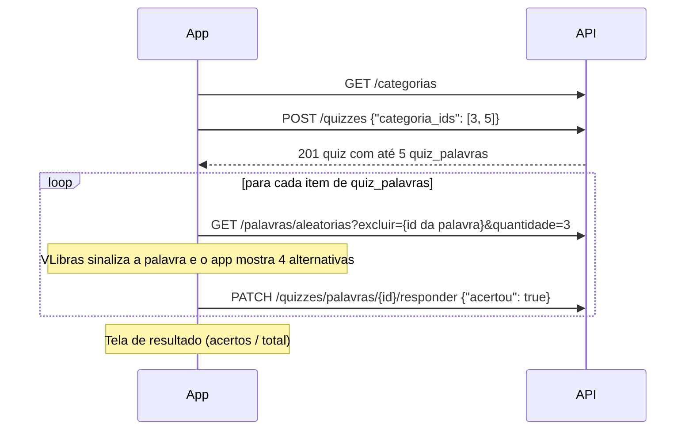
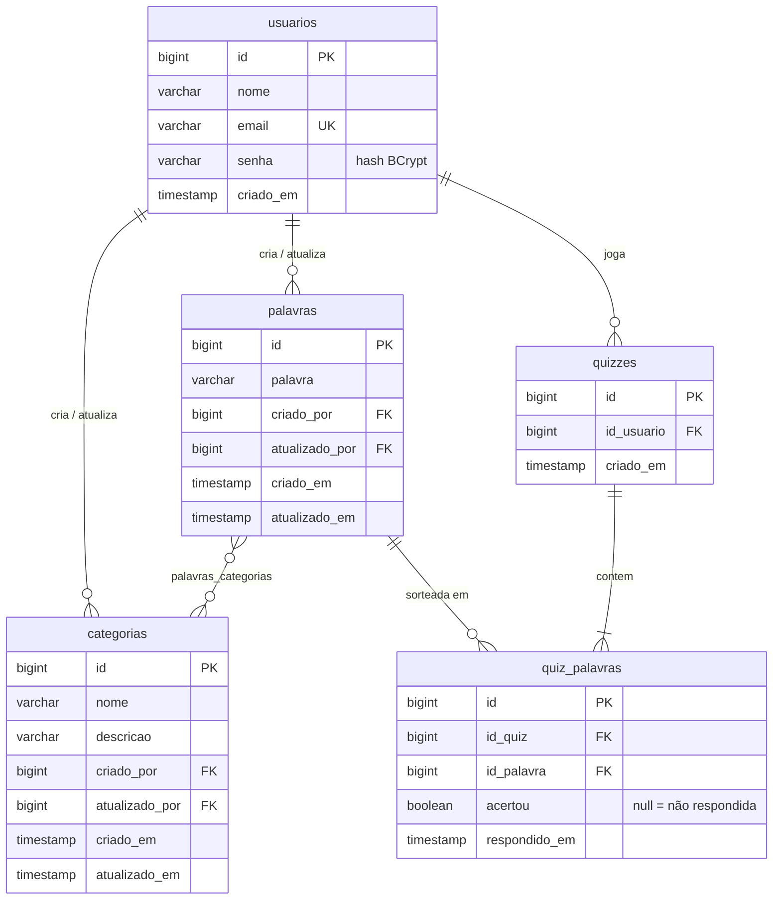

# Sinalize Mobile

Quiz interativo para aprender **Libras** (Língua Brasileira de Sinais). Um avatar 3D do
[VLibras](https://www.gov.br/governodigital/pt-br/vlibras) sinaliza uma palavra, e o jogador
escolhe entre quatro alternativas qual palavra foi sinalizada.

Este repositório leva para o mobile o projeto Sinalize, criado originalmente na disciplina de
Informática na Educação (TADS/UDESC) com NestJS + React. Ele tem duas partes:

| Parte | Pasta | Tecnologias |
|---|---|---|
| Back-end (API REST) | [`backend/`](backend) | Java 21, Spring Boot 3.5, Spring Web, Spring Data JPA, Bean Validation, Flyway, PostgreSQL 16 |
| App Android | [`android/`](android) | Kotlin, Jetpack Compose, MVVM (ViewModel + StateFlow), Navigation Compose, Retrofit + OkHttp |

> 🚧 O back-end está concluído; o app Android está em desenvolvimento. Este README é atualizado a cada etapa.

## Status

| Etapa | Descrição | Situação |
|---|---|---|
| B1 | Estrutura do back-end, docker-compose e configuração | ✅ |
| B2 | Migrations Flyway, entidades e dados iniciais | ✅ |
| B3 | Tratamento global de erros + Categorias | ✅ |
| B4 | Palavras | ✅ |
| B5 | Quizzes | ✅ |
| B6 | Usuários + testes de integração | ✅ |
| A1–A7 | App Android | ⏳ |

## Pré-requisitos

- **JDK 21**, com a variável `JAVA_HOME` apontando para ele (o Maven Wrapper usa o `JAVA_HOME`).
  Atenção: se o `JAVA_HOME` apontar para o JDK que vem com o Android Studio (`...\Android Studio\jbr`),
  o Maven usará esse JDK. Para usar o JDK 21 só na sessão atual do PowerShell:
  `$env:JAVA_HOME = "C:\caminho\do\jdk-21"`
- **Docker Desktop** (para o PostgreSQL)
- **Android Studio** com um emulador (API 26 ou superior)

Não é preciso instalar o Maven: o projeto usa o Maven Wrapper (`mvnw` / `mvnw.cmd`).

## Como executar o back-end

Os comandos abaixo são para o PowerShell, a partir da raiz do repositório.

1. Inicie o Docker Desktop e suba o banco:

   ```powershell
   docker compose up -d
   docker compose ps        # aguarde o status "healthy"
   ```

   O PostgreSQL fica disponível em `localhost:5433`, no banco `sinalize` (usuário e senha `sinalize`).

2. Rode a API:

   ```powershell
   cd backend
   .\mvnw.cmd spring-boot:run
   ```

   A API sobe em `http://localhost:8080`.

3. Confira se ela está no ar:

   ```powershell
   curl.exe http://localhost:8080/actuator/health
   # {"status":"UP"}
   ```

### Configuração

Os valores padrão estão em [`backend/src/main/resources/application.yml`](backend/src/main/resources/application.yml)
e podem ser sobrescritos por variáveis de ambiente:

| Variável | Padrão | Uso |
|---|---|---|
| `DB_URL` | `jdbc:postgresql://localhost:5433/sinalize` | URL JDBC do banco |
| `DB_USER` / `DB_PASSWORD` | `sinalize` / `sinalize` | Credenciais (também usadas pelo `docker-compose.yml`) |
| `DB_PORT` | `5433` | Porta exposta pelo container do banco |
| `SERVER_PORT` | `8080` | Porta da API |

Na primeira subida, o Flyway cria as tabelas e carrega os dados iniciais (veja [Modelo de dados](#modelo-de-dados)).
No log deve aparecer `Successfully applied 2 migrations to schema "public"`.

### Parar o ambiente

```powershell
docker compose down        # para o banco e mantém os dados
docker compose down -v     # para o banco e apaga os dados (o Flyway recria tudo na próxima subida)
```

### Testes automatizados

São 78 testes, em dois grupos:

| Comando | O que roda | Precisa do banco? |
|---|---|---|
| `.\mvnw.cmd test` | 74 testes de unidade: controllers com `@WebMvcTest` (MockMvc) e services com Mockito | Não |
| `.\mvnw.cmd verify` | Os testes de unidade + 4 testes de integração (`SinalizeApiIT`): aplicação completa contra o PostgreSQL real | Sim (`docker compose up -d`) |

```powershell
cd backend
.\mvnw.cmd test
.\mvnw.cmd verify
```

Os testes de integração usam o mesmo container do PostgreSQL, mas no schema **`it`**, que o Flyway
apaga e recria a cada execução. Os dados de desenvolvimento (schema `public`) não são alterados. Eles
cobrem:
- as migrations e os dados iniciais;
- uma partida completa: criar o quiz, buscar as alternativas, responder todas as palavras e conferir
  o resultado gravado no banco;
- o ciclo de vida de uma palavra: criar, trocar as categorias e excluir;
- usuários: senha gravada como hash BCrypt e nunca devolvida, e-mail duplicado e exclusão bloqueada.

## API REST

Base: `http://localhost:8080`. O arquivo [`backend/requests.http`](backend/requests.http) traz
requisições prontas para o HTTP Client do IntelliJ ou para a extensão REST Client do VS Code.

### Convenções

- JSON em `snake_case`, com os mesmos nomes de campo do projeto original (`criado_em`, `criado_por`...).
- `POST` devolve **201 Created**, com o header `Location` e o recurso criado no corpo.
- `PATCH` faz atualização **parcial**: campos omitidos não mudam. Devolve **200** com o recurso atualizado.
- `DELETE` devolve **204 No Content**.
- Campos desconhecidos no corpo são rejeitados com 400.
- Datas no formato ISO-8601 (`2026-11-10T20:30:07.08866`).

### Formato de erro

Todos os erros seguem o mesmo formato, gerado pelo `GlobalExceptionHandler` (`@RestControllerAdvice`):

```json
{
  "timestamp": "2026-11-10T20:29:06.5433203-03:00",
  "status": 400,
  "error": "Bad Request",
  "message": "Dados inválidos.",
  "path": "/categorias",
  "campos": [
    { "campo": "descricao", "mensagem": "O campo descricao é obrigatório." },
    { "campo": "nome", "mensagem": "O campo nome é obrigatório." }
  ]
}
```

`campos` só aparece em erros de validação.

| Status | Quando |
|---|---|
| 400 | Validação, JSON malformado, campo desconhecido, parâmetro com tipo inválido |
| 404 | Recurso ou rota inexistente |
| 405 | Método HTTP não suportado na rota |
| 409 | Conflito com os dados existentes (ex.: e-mail duplicado, palavra já usada em quiz, palavra do quiz já respondida) |
| 422 | Requisição válida que uma regra de negócio impede (ex.: quiz com categorias sem palavras) |
| 415 | `Content-Type` diferente de `application/json` |
| 500 | Erro inesperado (detalhes só no log do servidor) |

### Categorias

| Método | Rota | Corpo | Resposta |
|---|---|---|---|
| GET | `/categorias` | – | 200, lista ordenada por data de criação |
| GET | `/categorias/{id}` | – | 200, ou 404 |
| POST | `/categorias` | `{"nome", "descricao"}`, ambos obrigatórios (máx. 255 / 400) | 201 |
| PATCH | `/categorias/{id}` | `{"nome"?, "descricao"?}`; se enviados, não podem estar em branco | 200, ou 404 |
| DELETE | `/categorias/{id}` | – | 204, ou 404. Remove os vínculos com palavras; as palavras continuam existindo |

Exemplo de resposta:

```json
{
  "id": 1,
  "nome": "Saudações",
  "descricao": "Cumprimentos e expressões de cortesia do dia a dia.",
  "criado_em": "2026-11-10T20:20:22.362653",
  "atualizado_em": null,
  "criado_por": { "id": 1, "nome": "Administrador" },
  "atualizado_por": null
}
```

Exemplo no PowerShell (`curl.exe` evita o alias `curl` do PowerShell):

```powershell
curl.exe -i -X POST http://localhost:8080/categorias -H "Content-Type: application/json" -d '{\"nome\":\"Esportes\",\"descricao\":\"Modalidades esportivas.\"}'
```

### Palavras

| Método | Rota | Entrada | Resposta |
|---|---|---|---|
| GET | `/palavras` | – | 200, lista com as categorias de cada palavra |
| GET | `/palavras/aleatorias` | Query: `excluir` (ids separados por vírgula, opcional) e `quantidade` (1 a 20, padrão 3) | 200, `[{"id", "palavra"}]` sorteadas entre todas as palavras |
| GET | `/palavras/{id}` | – | 200, ou 404 |
| POST | `/palavras` | `{"palavra", "categoria_ids": [..]}`, com ao menos 1 categoria | 201, ou 404 se alguma categoria não existir |
| PATCH | `/palavras/{id}` | `{"palavra"?, "categoria_ids"?}`; `categoria_ids` substitui todas as categorias | 200, ou 404 |
| DELETE | `/palavras/{id}` | – | 204, 404, ou **409** se a palavra já foi usada em algum quiz |

O app usa `/palavras/aleatorias?excluir=<id da palavra correta>&quantidade=3` para montar as
alternativas erradas do quiz.

Exemplo de resposta (`GET /palavras/9`):

```json
{
  "id": 9,
  "palavra": "Laranja",
  "criado_em": "2026-11-10T20:30:01.1055",
  "atualizado_em": null,
  "criado_por": { "id": 1, "nome": "Administrador" },
  "atualizado_por": null,
  "categorias": [
    { "id": 5, "nome": "Alimentos" },
    { "id": 3, "nome": "Cores" }
  ]
}
```

### Quizzes

| Método | Rota | Entrada | Resposta |
|---|---|---|---|
| POST | `/quizzes` | `{"categoria_ids": [..]}`, com ao menos 1 categoria | 201 com o quiz; 404 se alguma categoria não existir; **422** se as categorias não tiverem palavras |
| GET | `/quizzes` | – | 200, lista de quizzes com os itens |
| GET | `/quizzes/{id}` | – | 200, ou 404 |
| PATCH | `/quizzes/palavras/{quizPalavraId}/responder` | `{"acertou": true\|false}` | 200 com o item atualizado; 404; **409** se o item já foi respondido |

Regras:
- Cada quiz sorteia **até 5 palavras distintas** (`sinalize.quiz.quantidade-palavras`) entre as palavras
  das categorias escolhidas. Uma palavra que está em mais de uma categoria escolhida não aparece duas vezes.
- `quiz_palavras` vem na ordem em que as palavras devem ser apresentadas.
- `acertou` e `respondido_em` ficam `null` até o jogador responder. Cada item só pode ser respondido uma vez.
- As alternativas erradas não são gravadas: o app as busca em `/palavras/aleatorias`.

Fluxo de uma partida no app:



Exemplo de resposta (`POST /quizzes`):

```json
{
  "id": 2,
  "criado_em": "2026-11-10T20:39:21.510696",
  "usuario": { "id": 1, "nome": "Administrador" },
  "quiz_palavras": [
    { "id": 2, "acertou": null, "respondido_em": null, "palavra": { "id": 31, "palavra": "Verde" } },
    { "id": 3, "acertou": null, "respondido_em": null, "palavra": { "id": 32, "palavra": "Rosa" } }
  ]
}
```

### Usuários

| Método | Rota | Entrada | Resposta |
|---|---|---|---|
| GET | `/usuarios` | – | 200, lista de `{"id", "nome", "email", "criado_em"}` |
| GET | `/usuarios/{id}` | – | 200, ou 404 |
| POST | `/usuarios` | `{"nome", "email", "senha"}`, todos obrigatórios | 201, ou 409 se o e-mail já estiver em uso |
| PATCH | `/usuarios/{id}` | `{"nome"?, "email"?, "senha"?}` | 200, 404 ou 409 |
| DELETE | `/usuarios/{id}` | – | 204, 404, ou **409** se o usuário criou categorias ou palavras ou jogou quizzes |

Regras:
- **Senha**: de 6 a 20 caracteres, com pelo menos 1 letra maiúscula, 1 minúscula e 1 número ou símbolo
  (mesma regra do projeto original). É gravada com hash **BCrypt** e nunca aparece nas respostas.
- **E-mail**: gravado em minúsculas e sem espaços; não pode se repetir, sem diferenciar maiúsculas
  e minúsculas.
- Ainda não há login, como no projeto original: todas as operações são feitas em nome do usuário
  padrão (id 1). Essa regra fica isolada na interface `UsuarioLogadoProvider`, que pode ser trocada
  por uma implementação com autenticação sem alterar os services.

### Diferenças em relação à API original (NestJS)

| Original | Esta versão | Motivo |
|---|---|---|
| Respostas envelopadas (`{"message", "category"}`) | Corpo é o próprio recurso | Padrão REST; o status HTTP já informa o resultado |
| `POST` devolve 200 (padrão do NestJS) | 201 + `Location` | Semântica HTTP de criação |
| `DELETE` devolve 200 com mensagem | 204 sem corpo | Semântica HTTP de exclusão |
| `PATCH /categorias/{id}` exigia todos os campos | Atualização parcial | Era o comportamento esperado do PATCH (o DTO parcial existia, mas não era usado) |
| Erros no formato padrão do NestJS | Formato único com `campos` por campo | Facilita mostrar os erros no app |
| Campo `categoryIds` (camelCase) em palavras | `categoria_ids` | Mesmo padrão `snake_case` dos demais campos |
| `excluir=1,abc` ignorava silenciosamente o valor inválido | 400 com mensagem | Erros de entrada não passam despercebidos |
| `quantidade` sem limite | De 1 a 20 | Evita consultas grandes demais |
| Excluir palavra já usada em quiz gerava erro 500 (violação de FK) | 409 com mensagem clara | Erro tratado como regra de negócio |
| `POST /quizzes?categoriaIds=1,2` (query string) | `POST /quizzes` com corpo `{"categoria_ids": [1, 2]}` | Dados de criação vão no corpo da requisição |
| Quiz podia repetir uma palavra que estivesse em duas categorias escolhidas | Palavras sempre distintas | Correção do sorteio (subconsulta em vez de `JOIN`) |
| Categorias sem palavras: 404 | 422 | As categorias existem; o que falha é a regra de negócio |
| Uma palavra do quiz podia ser respondida várias vezes | 409 na segunda resposta | Preserva a primeira resposta do jogador |
| Itens do quiz incluíam as categorias de cada palavra; `GET /quizzes` trazia o e-mail do usuário | Apenas `id` e `palavra`; usuário só com `id` e `nome` | Respostas menores e sem dados pessoais desnecessários |
| Senha gravada em texto puro (`varchar(20)`) | Hash BCrypt | Segurança: a senha original nunca é armazenada |
| E-mail único diferenciava maiúsculas e minúsculas | E-mail normalizado em minúsculas | Evita contas duplicadas como `Ana@x.com` e `ana@x.com` |
| Trocar o e-mail para o próprio e-mail atual dava 409 | Permitido | A verificação ignora o próprio usuário |
| Excluir usuário com registros gerava erro 500 (FK) | 409 com mensagem clara | Erro tratado como regra de negócio |

## Modelo de dados

O esquema é versionado pelo Flyway em `backend/src/main/resources/db/migration` e segue a modelagem
do projeto original.



Regras de integridade:
- Ao excluir uma palavra ou uma categoria, os vínculos em `palavras_categorias` são removidos em cascata.
- Uma palavra que já apareceu em algum quiz não pode ser excluída (`ON DELETE RESTRICT` em `quiz_palavras`).
- Ao excluir um quiz, os itens dele (`quiz_palavras`) também são excluídos.

| Migration | Conteúdo |
|---|---|
| `V1__schema_inicial.sql` | Tabelas, chaves estrangeiras e índices |
| `V2__dados_iniciais.sql` | Usuário padrão, 6 categorias e 44 palavras |

**Dados iniciais:**
- Usuário padrão (id 1): `admin@sinalize.com.br` / `Sinalize123`. Como no projeto original, ainda não há
  login: todas as operações são registradas em nome desse usuário.
- Categorias: Saudações, Família, Cores, Animais, Alimentos e Lugares, com 6 a 9 palavras cada.
  "Laranja" está em duas categorias (Cores e Alimentos).

## Estrutura do repositório

```
sinalize-mobile/
├── docker-compose.yml   # PostgreSQL 16 para desenvolvimento
├── backend/             # API REST em Spring Boot
│   ├── mvnw, mvnw.cmd   # Maven Wrapper
│   ├── pom.xml
│   ├── requests.http    # requisições de exemplo
│   └── src/
│       ├── main/java/br/com/sinalize/api/
│       │   ├── controller/   # endpoints REST (só HTTP: status, rotas, validação de entrada)
│       │   ├── service/      # regras de negócio e transações
│       │   ├── repository/   # repositórios Spring Data JPA
│       │   ├── entity/       # entidades JPA
│       │   ├── dto/          # records de entrada (Request) e saída (Response)
│       │   ├── exception/    # exceções de negócio e GlobalExceptionHandler
│       │   ├── validation/   # validações customizadas (Bean Validation)
│       │   └── config/       # beans de configuração (BCrypt)
│       ├── main/resources/
│       │   ├── application.yml
│       │   └── db/migration/ # scripts do Flyway
│       └── test/
│           ├── java/.../controller/  # testes de controller (MockMvc)
│           ├── java/.../service/     # testes de service (Mockito)
│           ├── java/.../SinalizeApiIT.java   # testes de integração (PostgreSQL real)
│           └── resources/application-it.yml  # perfil dos testes de integração
└── android/             # app Android (Jetpack Compose)
```
